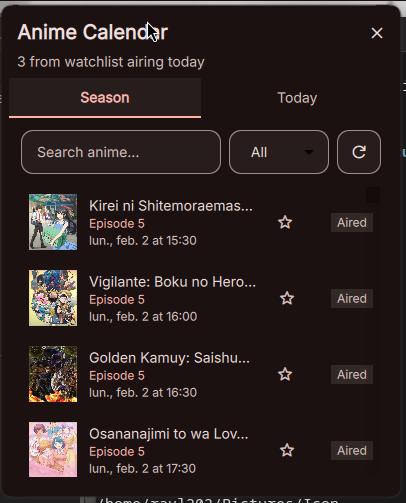
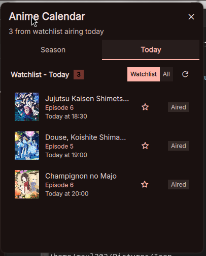
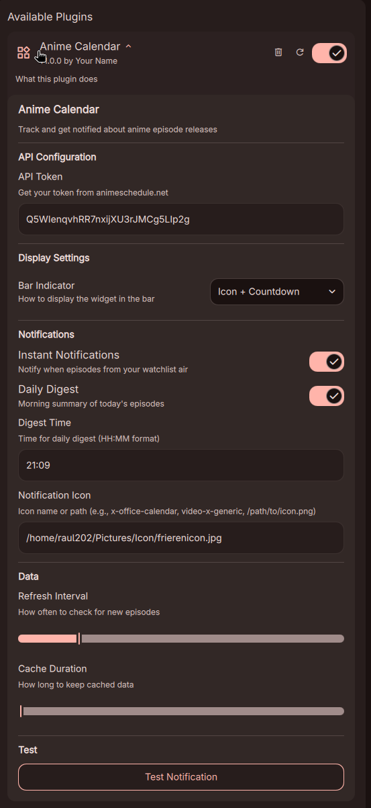

# Anime Calendar Plugin

A plugin for Dux Shell (DankMaterialShell 2.0) that tracks anime episode releases from [animeschedule.net](https://animeschedule.net) and sends notifications when your favorite shows air.

## Features

- **Week View** - Browse what airs this week, grouped by day, and step to previous or next weeks
- **Sub / Dub / Raw / All** - Pick which releases to show
- **Watchlist** - Star shows; see today's episodes or every starred show with its next episode, delays and finished shows
- **Real Dates** - Next episodes come from the API's timetable, with delayed episodes marked
- **Offline Cache** - The last fetched timetable shows right away on start and stays visible without network
- **Desktop Notifications** - Get notified when episodes air
  - Instant notifications when an episode starts
  - Daily digest summary of today's episodes
- **Customizable Bar Indicator** - Choose between icon only, icon + count, or icon + countdown
- **Custom Notification Icon** - Use your own icon for notifications

## Screenshots

### Week Tab


### Today Tab


### Settings


## Requirements

- [QuickShell](https://github.com/outfoxxed/quickshell)
- [Dux Shell](https://github.com/duxlabs-dev/dux-shell) 2.0 or newer (for older DankMaterialShell versions use the `dms-variant` branch)
- An API token from [animeschedule.net](https://animeschedule.net)
- `curl` (fetches the timetable)
- `notify-send` from libnotify (for desktop notifications)

## Installation

1. Clone this plugin into your plugins directory:
   ```
   git clone https://github.com/RiceaRaul/DMS-AnimeCalendarPlugin ~/.config/dms/plugins/animeCalendar
   ```

2. Enable the plugin in Settings → Plugins and add the widget to your bar

3. Create an application on [animeschedule.net](https://animeschedule.net/api/v3/documentation) to get an application token, and paste it in the plugin settings (the popout shows a setup screen with both links until a token is set)

## Configuration

### API Configuration
| Setting | Description |
|---------|-------------|
| API Token | Your animeschedule.net application token |
| API Token Path | File to read the token from instead (takes precedence over API Token) |

### Display Settings
| Setting | Description |
|---------|-------------|
| Bar Indicator | How to display in the bar: Icon Only, Icon + Count, or Icon + Countdown |

### Notifications
| Setting | Description |
|---------|-------------|
| Instant Notifications | Notify when episodes from your watchlist air |
| Daily Digest | Morning summary of today's episodes |
| Digest Time | Time for daily digest (HH:MM format) |
| Notification Icon | Icon name or path for notifications |

### Data Settings
| Setting | Description |
|---------|-------------|
| Refresh Interval | How often to check for new episodes (5-60 min) |

## Usage

1. **This week** - See what airs this week by day; use the arrows for other weeks
2. **Add to Watchlist** - Click the star icon on any anime to add it to your watchlist
3. **Today tab** - "Watchlist" shows today's episodes, "All" shows every starred show with its next episode or status
4. **Clear finished** - In "All", remove every finished show at once
5. **Receive Notifications** - Get notified when your anime airs

## File Structure

```
animeCalendar/
├── Daemon.qml           # Settings, watchlist saving, cache, notifications setup
├── Widget.qml           # Bar pill and popout
├── Settings.qml         # Plugin settings UI
├── components/
│   ├── WeekTab.qml      # Week view tab
│   ├── TodayTab.qml     # Watchlist tab
│   ├── AnimeListItem.qml # Anime list item component
│   ├── SetupState.qml   # No-token setup screen
│   └── LoadingState.qml  # Loading indicator
├── services/
│   ├── AnimeScheduleService.qml  # API and data management
│   └── NotificationService.qml   # Notification handling
└── screenshots/         # Screenshots for README
```

## Watchlist Storage

Your watchlist is stored in the plugin settings (DMS `plugin_settings.json`).
Versions before 1.0.2 kept it in `~/.config/quickshell/anime-watchlist.json`; that file is imported once on first start and can be deleted afterwards.
The cached timetable lives in the plugin state file (`~/.local/state/dms/plugins/animeCalendar_state.json`).

## License

MIT License

## Credits

- Anime data provided by [animeschedule.net](https://animeschedule.net)
- Built for [Dux Shell](https://github.com/duxlabs-dev/dux-shell)
